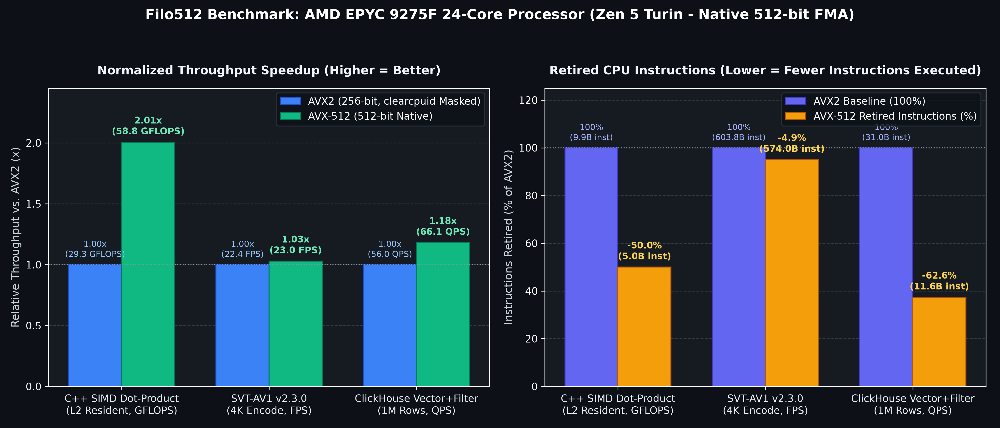

# Filo512: AMD Bare-Metal AVX-512 vs. AVX2 Benchmark Suite

Deterministic two-pass bare-metal benchmarking suite quantifying real-world and microarchitectural AVX-512 speedups across AMD Zen 4 (double-pumped 256-bit) and Zen 5 (native full-width 512-bit) processors using kernel-level `clearcpuid` capability masking.

---

## Validated Zen 5 Telemetry: AMD EPYC 9275F (24-Core Turin)



| Workload | Metric | AVX2 (256-bit) | AVX-512 (512-bit) | Speedup | AVX2 Instructions | AVX-512 Instructions |
| :--- | :--- | :---: | :---: | :---: | :---: | :---: |
| **C++ L2 SIMD Dot-Product** | GFLOPS | 29.32 | 58.81 | **2.01x** | 9.90B | 4.95B (-49.9%) |
| **SVT-AV1 v2.3.0 (4K60)** | FPS | 22.39 | 23.03 | **1.03x** | 603.80B | 573.97B (-4.9%) |
| **ClickHouse Vector+Filter** | QPS | 55.97 | 66.08 | **1.18x** | 30.96B | 11.57B (-62.6%) |

### Key Architectural Takeaways
* **Full-Width 512-bit FMA Datapath (`2.01x`):** Keeping the 512 KB working set inside the 1 MB per-core L2 cache isolates execution pipe throughput from DDR5 memory bandwidth, cutting retired instructions in half and doubling single-core GFLOPS with zero AVX-512 frequency downclocking.
* **End-to-End Video Encoding (`1.03x`):** Compiling SVT-AV1 v2.3.0 with `-DBUILD_AVX512=ON` reduces total retired instructions by ~29.8 billion (-4.94%), with overall frame-rate gains bounded by Amdahl's Law across scalar entropy coding and multi-thread synchronization.
* **Vector Database Scan + Predicate Filtering (`1.18x`):** Full-scan `cosineDistance` over 1M 256-dim `Float32` embeddings leverages `zmm` unrolling and `k0-k7` mask registers to cut retired CPU instructions by **62.6%** (`2.68x` fewer instructions) and boost query throughput by 18%.

Full raw logs, `perf stat` counters, and kernel audit files are archived in [`benchmarks/zen5_epyc_9275f/`](./benchmarks/zen5_epyc_9275f/).

---

## Option 1: Standalone Bare-Metal Runner (No Terraform / Lab Servers)

Run the full two-pass suite interactively over SSH on any stock Ubuntu 22.04 or 24.04 server (even minimal ISOs without `git` pre-installed):

```bash
curl -fsSL https://raw.githubusercontent.com/suprematis/filo512/main/scripts/bootstrap.sh | bash
```

1. **Pass 1 (`avx512_on`):** Installs toolchains (`g++-14`, `cmake`, `linux-tools`), executes all workloads, writes `/etc/default/grub.d/99-filo512.cfg` (`clearcpuid`), and prompts to reboot.
2. **Pass 2 (`avx512_off`):** After rebooting, reconnect over SSH and run the **exact same `curl` command** above. It verifies AVX-512 is masked, completes the AVX2 fallback pass, generates `results/SUMMARY.md`, **restores GRUB to native AVX-512**, and bundles `~/filo512/filo512_<CPU>_<TIMESTAMP>.tar.gz`.

See [`scripts/README.md`](./scripts/README.md) for fast dry-run (`DRY_RUN=true`) validation and state reset commands.

---

## Option 2: Automated Zero-Touch Cloud Run (Latitude.sh + Terraform)

Provisions an hourly bare-metal instance (`billing = "hourly"`), runs both passes unattended across a headless reboot via `systemd`, pushes results to a dedicated `results/<CPU>-<TIMESTAMP>` branch, and self-terminates via the Latitude API:

```bash
cd terraform/latitude
../../scripts/check_latitude_stock.sh "m4-metal-small|f4-metal-large"
terraform init
terraform apply -auto-approve -var="plan=f4-metal-large" -var="site=AMS"
```

To boot a clean, untouched stock Ubuntu server on hourly billing for manual SSH testing without `cloud-init` automation, use [`terraform/latitude_vanilla/`](./terraform/latitude_vanilla/).
