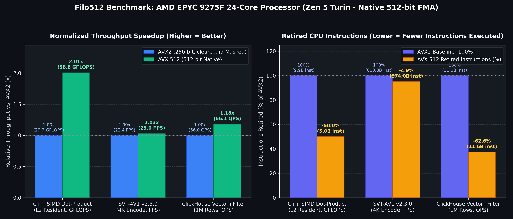

# Filo512: AMD AVX-512 vs. AVX2 Benchmark Summary
- **Processor:** `AMD EPYC 9275F 24-Core Processor`
- **Pass 1 Active AVX-512 Subsets:** `avx512f avx512dq avx512ifma avx512cd avx512bw avx512vl avx512_bf16 avx512vbmi avx512_vbmi2 avx512_vnni avx512_bitalg avx512_vpopcntdq avx512_vp2intersect`
- **Pass 2 Kernel Mask Status:** `NONE (AVX-512 Masked)`

| Workload Metric | AVX2 (256-bit) | AVX-512 (512-bit) | Speedup | Instructions (AVX2) | Instructions (AVX-512) |
| :--- | :---: | :---: | :---: | :---: | :---: |
| **C++ SIMD Dot-Product (GFLOPS)** | 29.3245 | 58.8063 | **2.01x** | 9,895,582,194 | 4,952,775,631 |
| **SVT-AV1 4K Encode (FPS)** | 22.393 | 23.025 | **1.03x** | 603,800,723,176 | 573,965,708,217 |
| **ClickHouse Vector+Filter (QPS)** | 55.97 | 66.08 | **1.18x** | 30,955,422,543 | 11,571,299,508 |

## Visual Telemetry Summary

